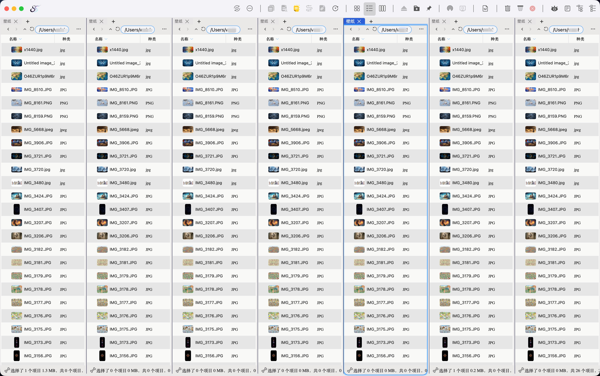
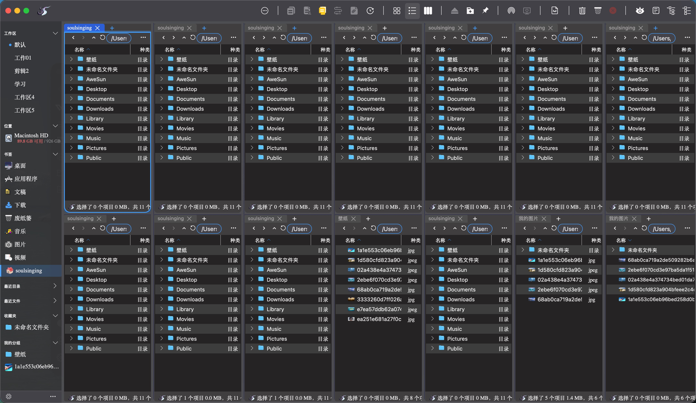

## 软件名称

SoulSinging  文件管理器

## **应用平台**

* MacOS
* Windows（暂时不支持，研发中）

## **是否收费**

付费，一次性买断，限时优惠，一次付款可以安装3台电脑。

## **一句简介**

方便直观的布局，极致的性能，快捷的操作让人爱不释手，再也回不去访达了

## **应用简介**

2026年10月10日 已完成功能：

1、适合多工作场景切换，快速进入工作状态，打开工作场景所需的所有文件窗口
        2、多窗口随意布局，可以按照自己的习惯布局文件明细查看窗口
        3、文件明细窗口实时更新文件信息，方便监控输出文件的结果
        4、双击空白或状态栏快速返回上级目录，简直太实用了
        5、最近20个目录历史访问记录、最近20个文件打开记录
        6、自定义书签，让工作效率加倍
        7、各种快捷键操作，让你随时唤出Soulsinging

## **截图预览：**

## **官方网站**

[www.soulsinging.cn](https://www.soulsinging.cn)

https://github.com/SoulSinging/soulsinging

百度网盘下载地址：
        百度网盘分享的文件：SoulSinging
        链接: https://pan.baidu.com/s/1NOE-KjrfEwjmdjM6pIhYUg?pwd=bd4x 提取码: bd4x
